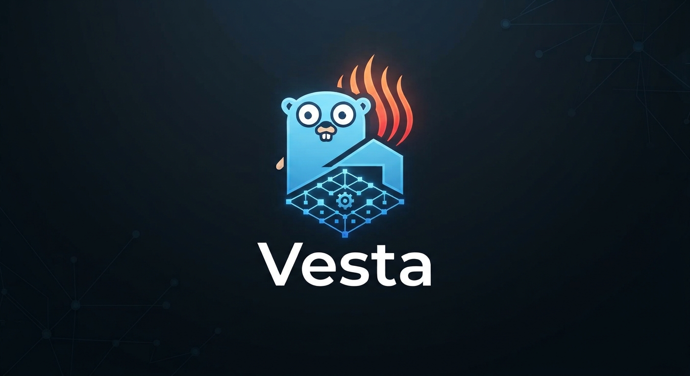

# Vestatherm VNC HTTP API

## What this is

[Vestatherm](https://www.ortner-cc.at/vestatherm-speicherofen-mit-waermepumpe/) is a heat pump that works with two heat sources, outside air and a masonry heater.
There are several values that can be read via Modbus TCP, but control is only possible through the integrated touch display or VNC.
This project is a wrapper to set specific values, like the buffer temperature, or to start maintenance tasks like defrosting.
It inherently does not include business logic, which is done through a home automation setup like openHAB or home assistant. 

## Build

```
GOOS=linux GOARCH=arm64 go build -o vestaapi-linux-arm64 cmd/server/main.go
```

## Security Considerations

The API does not offer any authentication and the VNC protocol is not secure. This controller should only be used in a safe environment.